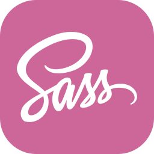
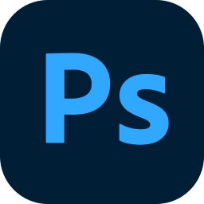
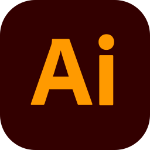
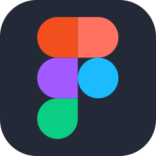
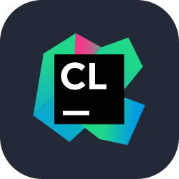

# Hi, I'm Andrew

Experienced C# and Web Developer, beginner Rust developer
My goal is to make something fun and goofy
i was born in Kaliningrad

## Creative Background:
- **Design:** Long-term professional experience in the design industry.
- **Photography:** Extensive background in professional photography and visual arts.

## Tech Stack:

### Development:

  
  
  
  
  
  
  
  
  

### Design & Graphics:

  
  
  
  

### IDEs & Software:

  
  
  

| Metric | Status / Activity |
| :--- | :--- |
| **Core Ecosystem** | C#, .NET, Rust development |
| **Current Focus** | Building scalable applications & tools |
| **Repositories** | Public projects and open-source contributions |
| **Fun Fact** | Combining engineering precision with a strong eye for design |

  

  <picture>
    <source media="(prefers-color-scheme: dark)" srcset="assets/github-contribution-grid-snake-dark.svg" />
    <source media="(prefers-color-scheme: light)" srcset="assets/github-contribution-grid-snake.svg" />
    
  </picture>

